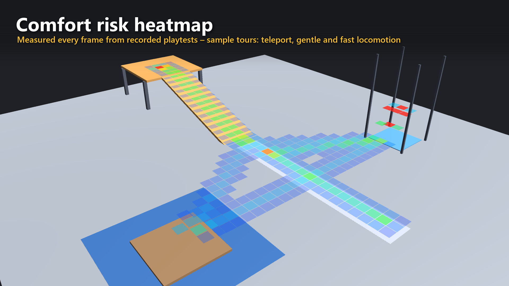
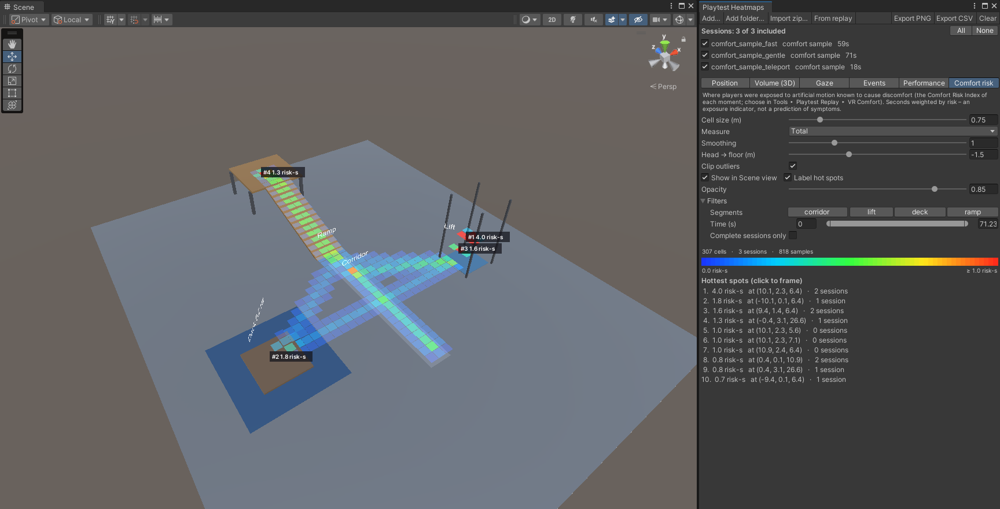
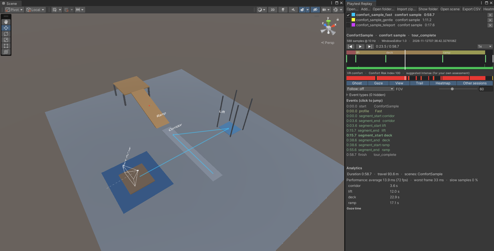
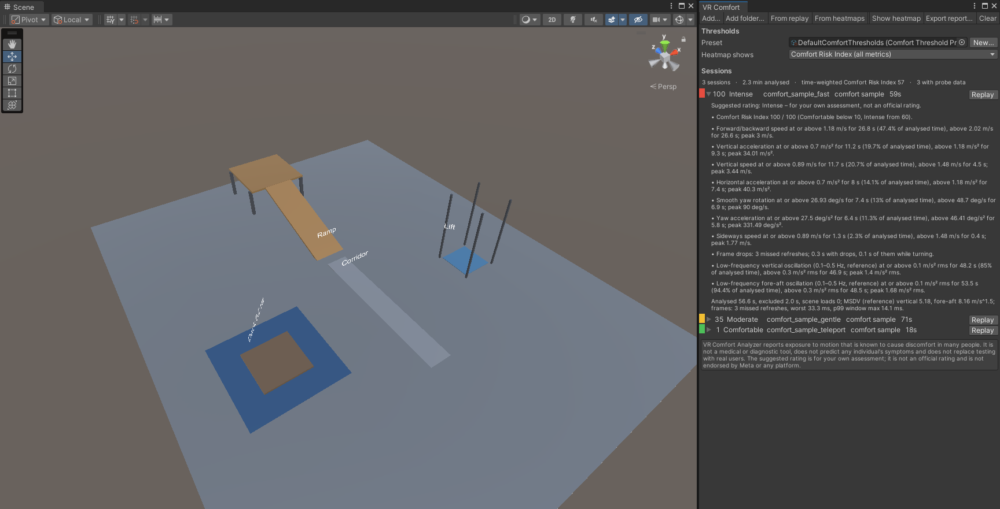
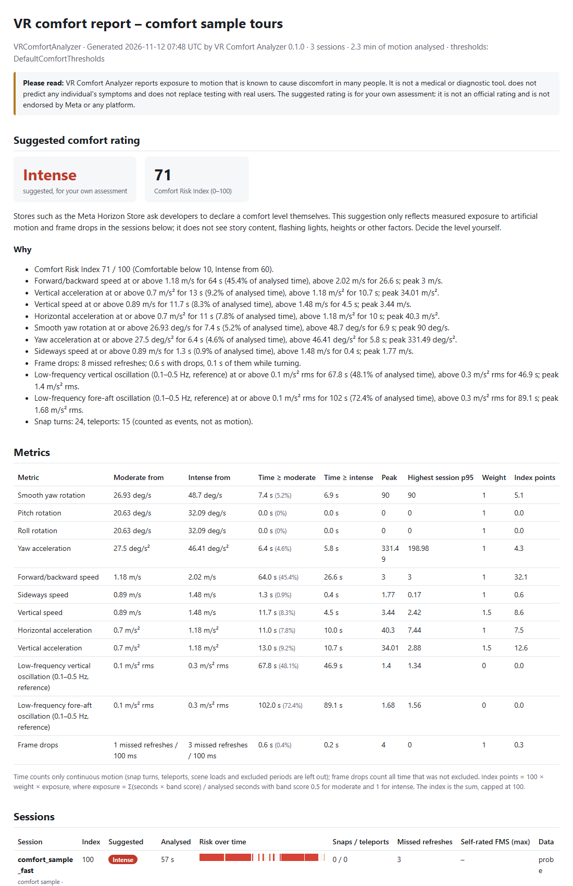

# VR Comfort Analyzer

[Manual](manual/) · [Changelog](changelog/) · [Support](#support)

An add-on for [Playtest Replay & Heatmaps](https://devirosnguyen.github.io/PlaytestReplay-Docs/). See where and when your VR
playtesters were exposed to motion that commonly causes discomfort – smooth turning, acceleration, vertical motion,
low-frequency sway and frame drops – as a heatmap, a timeline row and a report with a *suggested* comfort rating for your
own assessment.

**Requires Playtest Replay & Heatmaps 1.1 or newer.** Unity 2022.3 LTS and Unity 6 · Built-in, URP and HDRP · XR Origin,
OVRCameraRig or your own rig · no package dependencies, full C# source.

> **Please read.** VR Comfort Analyzer reports exposure to motion that is known to cause discomfort in many people. It is
> not a medical or diagnostic tool, does not predict any individual's symptoms and does not replace testing with real
> users. The suggested rating is for your own assessment; it is not an official rating and is not endorsed by Meta or any
> platform.

## Get started

1. Import Playtest Replay (1.1+), then this add-on.
2. Add **VR Comfort Probe** next to the **Playtest Recorder**. *Rig Kind = Auto* finds an XR Origin, an OVRCameraRig or the main camera.
3. Play, or let testers play. Each session now carries per-frame comfort data.
4. In the Editor: **Tools ▸ Playtest Replay ▸ VR Comfort**, add the sessions, then *Show heatmap* or *Export report…*.

No headset? Open the `ComfortSample` scene and press Play: an autopilot runs a tour (corridor, lift, bobbing deck, ramp)
with teleport, gentle or fast locomotion. Full details are in the [manual](manual/).

## Measure

- **Artificial vs physical motion.** The probe separates the rig moving (stick locomotion, smooth turning, vehicles, lifts)
  from the player moving their own head. Physical head motion is never scored on its own.
- **Snap turns, teleports, scene loads and cutscenes are events, not motion** – they never count as speed or acceleration.
- **Frame drops** against the display refresh rate, weighted more while the player turns.
- Every frame measured, stored as 100 ms windows in the session file (about 0.5 KB per second). No allocations per frame.
  Files stay readable by Playtest Replay 1.0.

## See

A new **Comfort risk** kind in the Heatmaps window, with all its filters and PNG/CSV export.

A **VR comfort row** under the replay timeline: moderate and intense stretches, snap turns and teleports. Hover for the
cause, click to jump.

The **VR Comfort window**: sessions sorted by Comfort Risk Index, with the metrics that drove each suggested rating.

## Report

A self-contained HTML report and CSV tables: suggested rating (Comfortable / Moderate / Intense) with reasons, Comfort Risk
Index per session, moments to review with time and place, the heatmap, and every threshold with its source.

## Thresholds with sources

Defaults come from published research (Terenzi & Zaal 2020, NASA Ames) with the source next to every value, in a preset
you can edit for your audience. An optional in-game **Fast Motion Sickness (FMS)** question lets you compare what testers
felt with what was measured. See [Thresholds, Comfort Risk Index and rating](manual/#4-thresholds-comfort-risk-index-and-rating).

## Status

Version 0.9 (pre-release). Not yet validated on a Meta Quest device – see the [changelog](changelog/).

## Support

E-mail: devirosnguyen@gmail.com

When reporting a problem, please include your Unity version, render pipeline, XR rig and the Console log.

---

This repository contains documentation only. VR Comfort Analyzer is sold on the Unity Asset Store by JieYingStudio.
