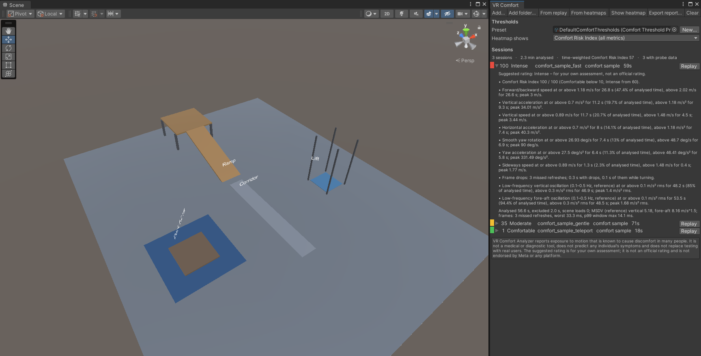
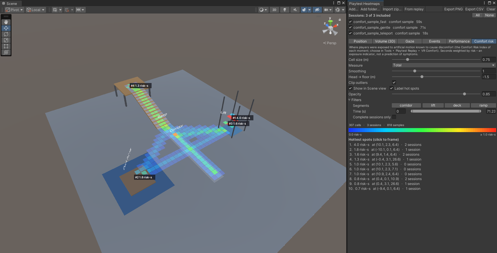
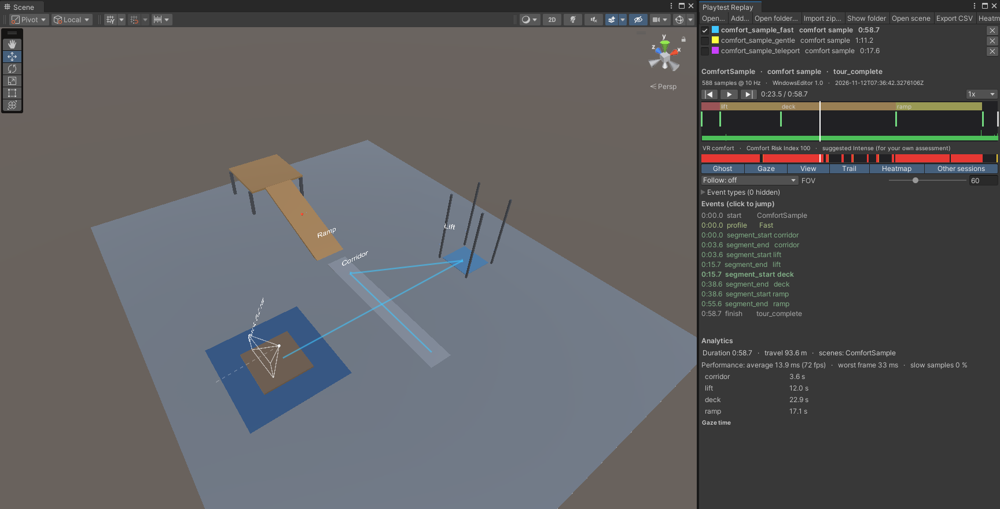
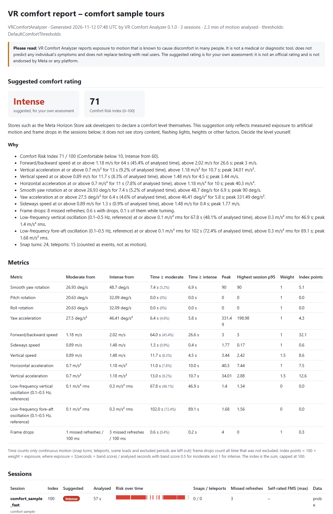

# VR Comfort Analyzer – Manual

[Home](../) · [Changelog](../changelog/)

Version 0.9 (pre-release) · requires Playtest Replay & Heatmaps 1.1+ · Unity 2022.3 LTS and Unity 6 · Built-in, URP and HDRP

An add-on for **Playtest Replay & Heatmaps** that shows **where and when players were exposed to motion that is known to cause discomfort in VR**: artificial rotation and acceleration of the rig, vertical motion, low-frequency oscillation and frame drops. You get a "Comfort risk" heatmap, a risk row under the replay timeline, a Comfort Risk Index per session and an HTML/CSV report with a *suggested* comfort rating for your own assessment.

> **Please read.** VR Comfort Analyzer reports exposure to motion that is known to cause discomfort in many people. It is not a medical or diagnostic tool, does not predict any individual's symptoms and does not replace testing with real users. The suggested rating is for your own assessment; it is not an official rating and is not endorsed by Meta or any platform.

## 1. Requirements

- **Playtest Replay & Heatmaps 1.1 or newer** (the add-on stores its data in the session files through the 1.1 add-on blocks; 1.0 cannot compile the add-on).
- Unity 2022.3 LTS or Unity 6; Built-in, URP or HDRP. No package dependencies (the Input System is used only if installed).
- Any XR setup: XR Interaction Toolkit (XR Origin), Meta OVRCameraRig, or your own rig.

## 2. Quick start

1. Import Playtest Replay (1.1+), then this add-on.
2. On the object with the **Playtest Recorder**, add **VR Comfort Probe** (*Add Component ▸ Playtest Replay ▸ VR Comfort Probe*). With *Rig Kind = Auto* it finds an XR Origin, an OVRCameraRig or the main camera; the tracking space is the camera's parent.
3. Play (or let testers play). Sessions are saved as usual; each now carries per-frame comfort data.
4. Open **Tools ▸ Playtest Replay ▸ VR Comfort**, add the sessions (or press *From replay* / *From heatmaps*). You see each session's Comfort Risk Index and suggested rating with the reasons.
5. **Show heatmap** opens the Heatmaps window on the *Comfort risk* kind; the Replay window shows a *VR comfort* row under the timeline. **Export report…** writes the HTML report and CSV tables.

Try it without a headset: open `Samples/Scenes/ComfortSample` and press Play – an autopilot runs a tour (corridor, lift, bobbing deck, ramp, a short excluded cutscene) with one of three locomotion profiles. Three recorded tours are in `Samples/SampleSessions`.

## 3. What is measured

**Artificial motion** is the motion of the eye caused by the rig (the tracking space) moving in the world: stick locomotion, smooth turning, vehicles, lifts, moving platforms. It is computed as *rig now applied to the current head position − rig before applied to the same head position*, so turning the rig around the head moves nothing and walking around the room moves nothing. **Physical** motion (the player moving their own head) is never scored on its own; it only makes frame drops weigh more.

Every frame is measured (no allocations) and stored as **100 ms windows**:

| Value | How |
|---|---|
| Yaw / pitch / roll rate | Window mean of the rig's angular velocity in the head's yaw frame (deg/s) |
| Forward / sideways / vertical speed | Window mean of the artificial eye velocity (m/s) |
| Yaw, horizontal and vertical acceleration | Window peak after a 0.1 s low-pass on velocity **and** on its derivative (frame jitter – e.g. a rig moved by 50 Hz physics on a 72 Hz display – is judder, not perceived acceleration) |
| Low-frequency oscillation (reference) | 0.1–0.5 Hz band of vertical and fore-aft acceleration (2nd-order Butterworth), running r.m.s. over 10 s, plus an MSDV-style dose √∫a²dt |
| Frame drops | Frames longer than 1.5 display refresh intervals, counted as missed refreshes; worst frame time |
| Head angular speed | Peak physical head rotation (context only) |

**Discontinuities are events, not motion:** a rig rotation of more than 10° *and* faster than 300°/s in one frame is a snap turn; an eye jump of more than 1 m *and* faster than 20 m/s is a teleport; scene loads and rig changes are flagged. Neither creates speed or acceleration on either side. Call `PlaytestComfort.MarkDiscontinuity()` when you move the rig yourself, and wrap cutscenes or game-driven cameras in `PlaytestComfort.BeginExclusion()` / `EndExclusion()` – that time is recorded but not analysed.

## 4. Thresholds, Comfort Risk Index and rating

Thresholds live in a **Comfort Threshold Preset** asset (*Create ▸ Playtest Replay ▸ Comfort Threshold Preset*, or *New…* in the VR Comfort window). Each row has a *moderate* band, an *intense* band, a weight and its source. Defaults (`Presets/DefaultComfortThresholds`):

| Metric | Moderate / intense | Weight | Source |
|---|---|---|---|
| Smooth yaw rotation | 26.9 / 48.7 deg/s | 1 | Terenzi & Zaal 2020: 0.47 ± 0.38 rad/s (moderate = mean, intense = mean + 1 SD) |
| Pitch rotation | 20.6 / 32.1 deg/s | 1 | No direct data: roll values (pitch and roll provoke more than yaw) |
| Roll rotation | 20.6 / 32.1 deg/s | 1 | Terenzi & Zaal: 0.36 ± 0.20 rad/s |
| Yaw acceleration | 27.5 / 46.4 deg/s² | 1 | Terenzi & Zaal: 0.48 ± 0.33 rad/s² |
| Forward/backward speed | 1.18 / 2.02 m/s | 1 | Terenzi & Zaal: 1.18 ± 0.84 m/s |
| Sideways speed | 0.89 / 1.48 m/s | 1 | Terenzi & Zaal: 0.89 ± 0.59 m/s |
| Vertical speed | 0.89 / 1.48 m/s | 1.5 | No direct data: sideways values, ×1.5 for vertical motion |
| Horizontal acceleration | 0.70 / 1.18 m/s² | 1 | Terenzi & Zaal: forward 0.70 ± 0.48 m/s² |
| Vertical acceleration | 0.70 / 1.18 m/s² | 1.5 | No direct data: forward values, ×1.5 |
| Low-frequency vertical / fore-aft | 0.1 / 0.3 m/s² rms | **0** | Reference only (Bos & Bles 1998; Diels & Howarth 2013; MSDV per ISO 2631-1 was validated for ships). Reported, not scored: starting and stopping also put energy in this band |
| Frame drops | 1 / 3 missed refreshes per 100 ms | 1 (×2 while turning) | This tool's choice; Meta VRC.Quest.Performance.1 asks for a steady frame rate |

People differ widely – the published standard deviations are 50–90 % of the means. Edit the preset for your audience, ideally with your testers' FMS ratings (§6).

- **Exposure** of a metric = Σ(seconds × band score) / analysed seconds, with band score 0.5 for moderate and 1 for intense. Only continuous motion counts (frame drops: all time that is not excluded).
- **Comfort Risk Index** = 100 × min(1, Σ weight × exposure). It measures exposure, not a likelihood of symptoms.
- **Suggested rating:** Comfortable below 10, Intense from 60, Moderate between; artificial motion above a moderate band for 5 % of the time or more rules out Comfortable. Every rating lists the metrics that drove it. Stores such as the Meta Horizon Store ask you to declare a comfort level yourself; this suggestion does not see story content, flashing lights, heights and other factors.

## 5. Windows and report

- **VR Comfort window** – preset, what the heatmap shows (the index or one metric), sessions sorted by index with reasons, MSDV and frame statistics, *Replay*, *Show heatmap*, *Export report…*.

  

- **Heatmaps ▸ Comfort risk** – each window adds risk × seconds at the eye position ("risk-s"). All Playtest Replay heatmap features work: filters, Total/Reach, smoothing, hottest spots (click to frame), PNG/CSV export.

  

- **Replay ▸ VR comfort row** – yellow = moderate, red = intense, white ticks = snap turns, blue = teleports; hover for the metrics above their bands; click or drag to scrub. The label shows the session's index and suggested rating.

  

- **Report** (`name.html`, self-contained, prints well): disclaimer, suggested rating with reasons, metrics with index points, sessions with risk strips and self-rated FMS, **moments to review** (stretches of elevated risk with time, place and cause), the top-down comfort heatmap with hot spots, method, thresholds with sources, references. CSV: `name_sessions.csv`, `name_metrics.csv`, `name_windows.csv` (every 100 ms window).

  


Sessions recorded without the probe still work: their values are derived from the 10 Hz head samples, where head and rig motion cannot be separated – an upper bound, marked as such everywhere.

## 6. Components and API

### VR Comfort Probe (`PlaytestComfortProbe`)

| Field | Default | Meaning |
|---|---|---|
| Recorder | empty | Recorder to attach to; empty = the active one |
| Rig Kind | Auto | Auto / XR Origin / OVRCameraRig / Generic |
| Head, Origin | empty | Generic rigs: the camera and the tracking space (empty origin = the camera's parent) |
| Settings | see §3 | Window length, snap and teleport thresholds, smoothing, refresh rate |
| Detect Refresh Rate | on | Reads the XR display (or screen) refresh rate for frame-drop counting |

### VR Comfort FMS Prompt (`PlaytestComfortFmsPrompt`, optional)

Every few minutes while recording, a panel in front of the player asks for a rating on the **Fast Motion Sickness scale** (0 = no discomfort … 20 = frank sickness; Keshavarz & Hecht 2011). Thumbstick or arrow keys change the value, trigger or Enter answers; it closes by itself after 20 s. Answers are `fms` events and appear in the report next to the measured exposure – they are not used in the index. Ask your testers' consent, and let them stop at any time.

### Static API – `PlaytestComfort`

```csharp
PlaytestComfort.SetContext("locomotion", "smooth");   // also "vignette", "snap_angle", anything you like
PlaytestComfort.MarkDiscontinuity("teleport");         // you moved the rig instantly
PlaytestComfort.BeginExclusion("cutscene");            // … PlaytestComfort.EndExclusion();
PlaytestComfort.ReportFms(score);                      // from your own UI
```

Analysis from code: `ComfortTrack.For(recording)`, `ComfortAnalysis.Analyze(track, preset)`, `ComfortAnalysis.Combine(results)`, `ComfortReport` (HTML/CSV).

## 7. Data and performance

Comfort data is an add-on block (`com.jieyingstudio.comfort/1`) inside the `.ptrec` file, written with the recorder's regular flushes: about **0.5 KB per second** of play (≈ 30 KB per minute) after compression. Files stay readable by Playtest Replay 1.0, which skips the block. The probe allocates nothing in frames without a write.

## 8. Limitations

- Thresholds come from small studies with large differences between people; the index is an exposure indicator, not a prediction.
- The low-frequency indicator cannot yet tell oscillation (a bobbing boat) from stop-and-go locomotion, so it is reported but not scored by default.
- Abrupt changes (stepping onto a ramp or a raised platform) are real accelerations and show up briefly.
- Recordings without the probe give upper bounds only. Device validation on Meta Quest is pending (see the changelog).

## 9. Troubleshooting

| Problem | Fix |
|---|---|
| Sessions show "head samples (upper bound)" | Add the VR Comfort Probe next to the recorder. If *Rig Kind = Auto* picks the wrong camera, use *Generic* and assign *Head* and *Origin*. |
| Smooth turning shows up as sideways speed | The rig turns around its origin, not the head; turning around the head (as most rigs do) avoids moving the view. Turning around the origin is real artificial motion. |
| Constant vertical acceleration on a moving platform | Your rig follows the platform at the physics rate; follow it in `Update`/`LateUpdate` or interpolate. |
| Snap turns counted as rotation | Snap faster than 300°/s (one frame) or lower *Snap Rate* in the probe settings. |

## 10. References

Terenzi & Zaal (2020), NASA Ames, NTRS 20200000787 · Kelly et al. / Farmani & Teather on snap turning (arXiv 2406.14212) · Bos & Bles (1998) · Diels & Howarth (2013), Human Factors 55(3) · ISO 2631-1:1997 Annex D · So, Lo & Ho (2001), Human Factors 43(3) · Keshavarz & Hecht (2011), Human Factors 53(4) · Meta Horizon developer documentation (comfort ratings, VRC.Quest.Performance.1).

## 11. Support

E-mail: devirosnguyen@gmail.com – please include your Unity version, render pipeline, XR rig and the Console log.
